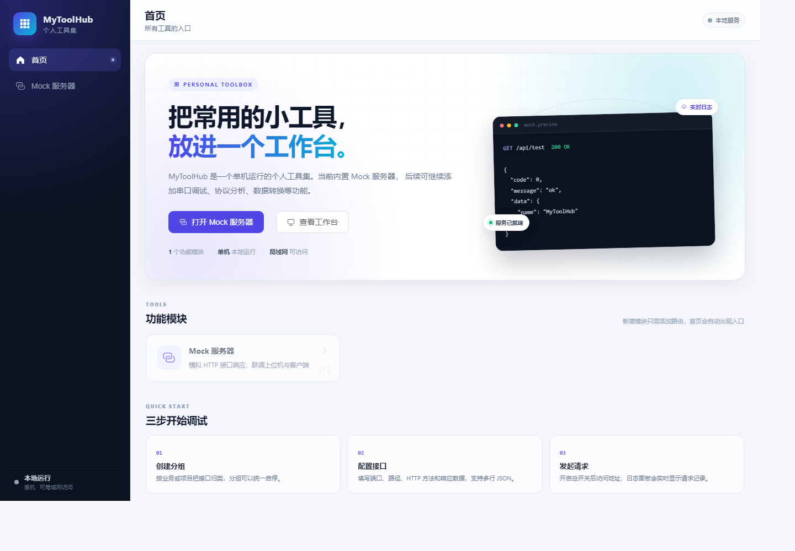
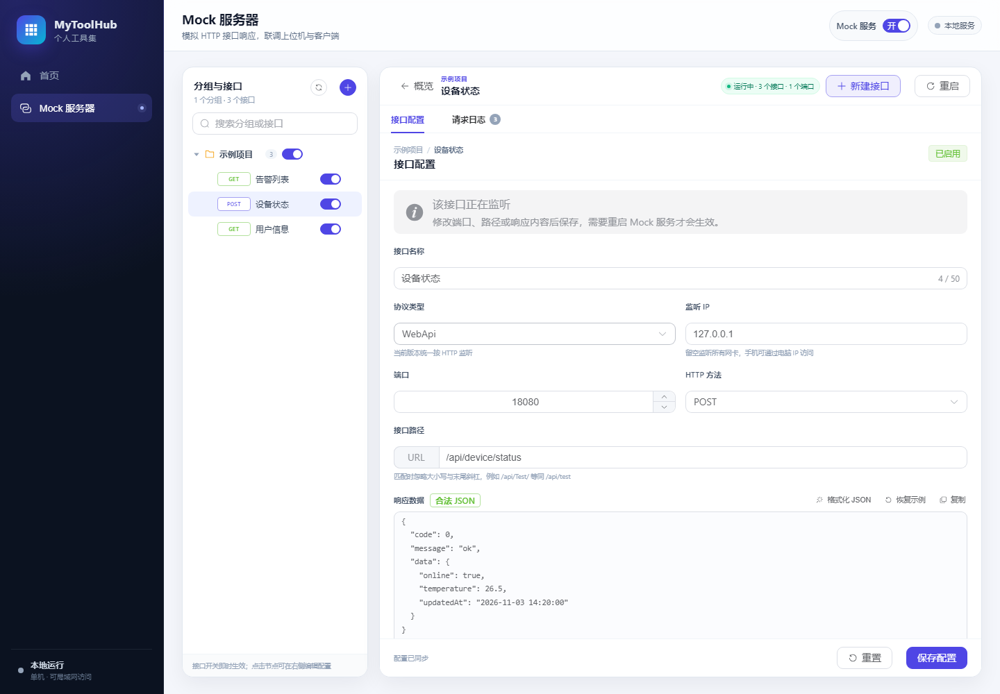
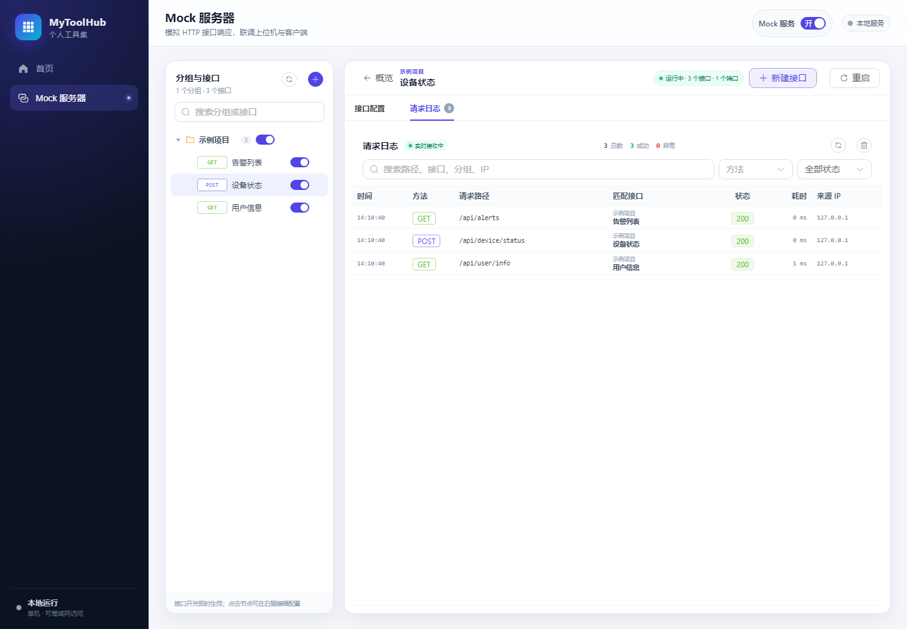
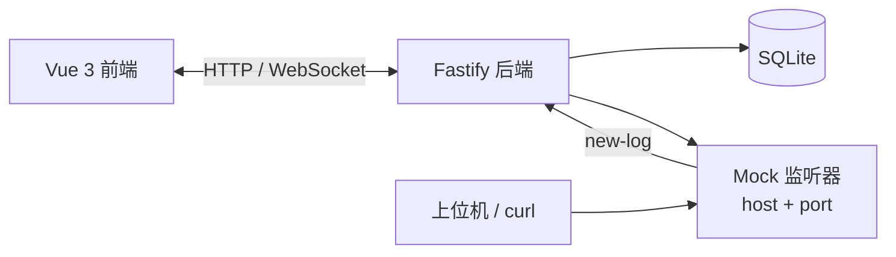

# MyToolHub

<p align="center">
  <strong>一个单机运行、可持续扩展的个人工具集</strong><br>
  首个模块：Mock 服务器 · 可视化配置 · 动态监听 · 实时请求日志
</p>

<p align="center">
  
  
  
  
  
</p>

<p align="center">
  
</p>

MyToolHub 是一个**单机运行的个人工具集桌面应用**。后端使用 Fastify + TypeORM + SQLite，前端使用 Vue 3 + Vite + Element Plus。

第一个功能是 **Mock 服务器**：可视化配置 HTTP 接口，动态启动本地监听，把模拟数据返回给上位机、客户端或其他服务，并通过 Socket.IO 实时查看请求日志。

> 项目只面向个人使用：单机 Windows，偶尔在局域网内用手机访问。设计目标是简单、直接、能持续加功能，因此没有引入插件容器、依赖注入框架、微服务、消息队列、Docker、Redis 等重型设施。

当前版本 **v1.0.0**。后续可以按同一套扩展点加入串口调试、协议分析、数据转换、报表生成等模块。

---

## 功能特性

| 能力 | 说明 |
| --- | --- |
| Mock 分组 | 创建、重命名、启用/停用、删除分组；分组名称全局唯一（不区分大小写） |
| Mock 接口 | 配置协议类型、监听 IP、端口、路径、HTTP 方法、多行响应数据 |
| 动态监听 | 按 host + port 创建监听器，同端口多个接口按“方法 + 路径”在内部路由 |
| 总开关 | 一键启动/停止全部已启用接口；启动失败会自动回滚为关闭，并返回明确原因 |
| 配置重启提示 | 运行中修改已启用接口会提示“需重启”，支持一键重启全部监听 |
| 实时请求日志 | 通过 Socket.IO 推送 `new-log` 事件，日志面板实时刷新；内存最多保留 500 条 |
| 响应处理 | 响应数据是合法 JSON 时压缩后返回，否则按纯文本原样返回 |
| 移动端适配 | 手机浏览器自动切换底部导航、抽屉分组树和单列布局 |
| 本地持久化 | 分组与接口保存在 SQLite，重启程序后配置仍然存在 |
| Windows 分发 | 可打包成内置 Node.js 运行时的单文件 EXE，双击即用 |

## 技术栈

| 层面 | 技术 |
| --- | --- |
| 前端 | Vue 3 + Vite 5 + Element Plus + Pinia + Vue Router |
| 后端 | Fastify 4 + Socket.IO 4 + TypeORM 0.3 |
| 数据 | SQLite（better-sqlite3） |
| 语言 / 工程 | TypeScript 5（strict）+ pnpm workspace |
| 分发 | Windows 单文件 EXE（内置 Node.js 运行时） |

### 界面预览

<p align="center">
  
  
</p>

左侧管理分组与接口，右侧编辑监听参数和响应数据；请求到达后，日志会实时出现在“请求日志”标签页。

## 工作原理



- 前端通过 REST API 管理配置，通过 Socket.IO 接收实时日志。
- 后端把配置持久化到 SQLite，并按 host + port 聚合启动 Mock 监听器。
- 监听器收到请求后，按 HTTP 方法 + 路径匹配接口，返回配置的响应数据，同时写入内存日志并推送前端。

## 快速开始

### 环境要求

- Node.js **20 LTS 或以上**（本项目在 Node.js 24 上验证）
- pnpm **8.x**
- 源码模式支持 Windows / macOS / Linux；单文件 EXE 仅支持 Windows 10/11 64 位

如果还没有 pnpm：

```bash
corepack enable
corepack prepare pnpm@8.15.9 --activate
```

### 开发模式

```bash
git clone https://github.com/ze520ze/MyToolHub.git
cd MyToolHub
pnpm install
pnpm dev
```

启动后：

- 前端：<http://localhost:5173>
- 后端 API：<http://localhost:3000>
- 健康检查：<http://localhost:3000/api/health>

开发模式下，Vite 会把 `/api` 和 `/socket.io` 代理到 `http://127.0.0.1:3000`，不需要额外配置 CORS。

### 生产模式

```bash
pnpm build
pnpm start
```

构建完成后，后端会托管 `packages/frontend/dist` 中的静态文件，只启动后端即可访问：

```text
http://localhost:3000
```

### Windows 单文件 EXE

如果只想双击运行，不想在目标机器上安装 Node.js 和 pnpm：

```bash
pnpm package:win
```

脚本会构建前端、编译后端、收集生产依赖并内置 Node.js 运行时，输出：

```text
release\MyToolHub.exe
release\使用说明.txt
```

双击 `MyToolHub.exe` 后：

- 首次运行会解压到 `%LOCALAPPDATA%\MyToolHub\app-版本ID`，以后启动直接复用，并自动清理旧版本目录。
- 自动从 3000 开始寻找可用端口，实际端口写入 `%LOCALAPPDATA%\MyToolHub\port.txt`。
- 用 Edge 或 Chrome 的应用窗口打开界面，系统托盘常驻，可重新打开、复制局域网地址、打开数据目录或退出。
- 数据库保存在 `%LOCALAPPDATA%\MyToolHub\data\toolhub.db`，覆盖升级 exe 不会丢数据。

注意：

- 目标机器需要 Windows 10/11 64 位，以及 Microsoft Edge 或 Google Chrome；不需要单独安装 Node.js。
- 打包脚本只支持 Windows，使用系统自带的 .NET Framework `csc.exe` 编译启动器。
- EXE 没有代码签名，首次运行可能被 SmartScreen 拦截；选择“更多信息 → 仍要运行”即可。
- `release/` 已加入 `.gitignore`，仓库不提交约 48 MB 的 EXE；需要时在本地执行 `pnpm package:win`。
- 手机访问时，需要允许 Windows 防火墙的专用网络入站。

## 使用 Mock 服务器

1. 打开首页的 **Mock 服务器**。
2. 点击分组面板右上角的 **+** 新建分组，例如“示例项目”。
3. 在分组节点上点击 **+** 新建接口，填写名称、端口、路径、HTTP 方法和响应数据。
4. 保存后接口默认是 **停用** 状态；打开分组树中的接口开关启用它。
5. 打开页面右上角的 **Mock 服务** 总开关，服务会为所有已启用接口启动监听。
6. 用浏览器、curl 或上位机访问 `http://localhost:端口/路径`。
7. 请求会实时出现在 **请求日志** 标签页；点击日志行可以查看响应和复制完整 JSON。
8. 运行中修改已启用接口的响应数据并保存，会提示“配置已保存，需重启 Mock 服务后生效”，可点击“立即重启”。

### 请求示例

假设创建了一个 GET 接口，端口 `8080`，路径 `/api/test`：

```bash
curl "http://127.0.0.1:8080/api/test"
```

如果接口配置的是 POST：

```bash
curl -X POST "http://127.0.0.1:8080/api/test" \
  -H "Content-Type: application/json" \
  -d "{\"hello\":\"world\"}"
```

### 监听与匹配规则

- IP 留空表示绑定 `0.0.0.0`，即监听所有网卡；填写 `127.0.0.1` 则只允许本机访问。
- 同一个 host + port 只会创建一个 HTTP 监听器；同端口的多个接口按 **HTTP 方法 + 路径** 在内部路由。
- 路径匹配忽略大小写、忽略末尾斜杠、忽略 query。例如 `/Api/Test/` 与 `/api/test` 视为同一路径。
- 路径或方法冲突会在启动/启用时返回明确错误，不会覆盖已有接口。
- 响应数据是合法 JSON 时，返回前会执行 `JSON.parse + JSON.stringify` 压缩；否则原样返回纯文本。
- 未匹配到接口时返回 404 和 `{ "code": "MOCK_NOT_FOUND", "message": "未找到匹配的 Mock 接口" }`。
- 每次请求都会生成日志并通过 Socket.IO 的 `new-log` 事件推送，最多保存 500 条。

### 重启与停用

- 修改已启用接口的配置不会立即改变正在运行的监听器，需要重启后生效。
- 停用接口会立即移除对应路由；该端口没有其他接口时会关闭监听器并释放端口。
- 总开关关闭会停止所有监听器并释放端口。
- 总开关的运行状态只保存在内存中，程序重启后默认是关闭；配置本身会持久化。

## 项目结构

```text
MyToolHub/
├── package.json                  workspace 根配置与脚本
├── pnpm-workspace.yaml           工作区定义
├── tsconfig.base.json            TypeScript 共享配置
├── docs/
│   ├── how-to-add-module.md      新增功能模块教程
│   └── images/                   README 截图
├── packaging/
│   └── launcher/                 Windows 单文件启动器（C#）
├── scripts/
│   ├── setup.ps1                 检查环境并安装依赖
│   ├── dev.ps1                   一键启动开发环境
│   ├── package-win.ps1           打包 Windows 单文件 EXE
│   └── README.md                 脚本使用说明
└── packages/
    ├── shared/                   前后端共享类型
    │   └── src/types/
    │       ├── mock.types.ts
    │       └── log.types.ts
    ├── backend/
    │   ├── data/                 SQLite 数据文件（不提交 Git）
    │   └── src/
    │       ├── server.ts         进程入口
    │       ├── app.ts            Fastify 实例组装
    │       ├── db/               TypeORM 数据源
    │       ├── modules/          功能模块（扩展点）
    │       │   └── mock/         Mock 模块
    │       ├── gateways/         Socket.IO 网关
    │       └── plugins/          模块注册中心
    └── frontend/
        └── src/
            ├── views/            页面（扩展点）
            ├── router/           路由表（扩展点）
            ├── stores/           Pinia 状态
            ├── api/              HTTP / Socket.IO 封装
            ├── components/       通用与业务组件
            ├── layouts/          布局
            └── styles/           全局样式
```

## 新增功能模块

新增功能只需要改三个地方：

1. **后端**：在 `packages/backend/src/modules/` 下新增模块目录，导出 `BackendModule` 对象，然后在 `packages/backend/src/plugins/register-modules.ts` 的 `modules` 数组中加一项。
2. **前端**：在 `packages/frontend/src/views/` 下新增页面，在 `packages/frontend/src/router/index.ts` 的 `navigationRoutes` 中添加带 `meta` 的路由项。
3. **共享类型**（可选）：在 `packages/shared/src/types/` 下新增类型，并在 `packages/shared/src/index.ts` 导出。

首页卡片和侧边导航会自动读取路由 `meta`，**不需要修改 `App.vue`、`HomeView.vue` 等主壳代码**。

完整示例（以“串口调试”为例）见 [docs/how-to-add-module.md](docs/how-to-add-module.md)。

## Mock API

Mock 接口以 `/api/mock` 为前缀；健康检查为 `/api/health`。

| 方法 | 路径 | 说明 |
| --- | --- | --- |
| GET | `/api/health` | 健康检查（含模块列表） |
| GET | `/api/mock/groups` | 获取所有分组（含接口） |
| POST | `/api/mock/groups` | 创建分组 |
| PUT | `/api/mock/groups/:id` | 更新分组 |
| DELETE | `/api/mock/groups/:id` | 删除分组及其接口 |
| POST | `/api/mock/interfaces` | 创建接口 |
| PUT | `/api/mock/interfaces/:id` | 更新接口 |
| DELETE | `/api/mock/interfaces/:id` | 删除接口 |
| POST | `/api/mock/interfaces/:id/enable` | 启用接口（启动监听） |
| POST | `/api/mock/interfaces/:id/disable` | 停用接口（停止监听） |
| POST | `/api/mock/master/toggle` | 总开关，body: `{ "enabled": true }` |
| POST | `/api/mock/restart` | 立即重启全部监听 |
| GET | `/api/mock/status` | 获取运行状态 |
| GET | `/api/mock/logs` | 获取最近 500 条请求日志 |

错误响应统一为：

```json
{
  "code": "MOCK_PORT_IN_USE",
  "message": "端口 8080 已被占用，请更换端口或关闭占用该端口的程序",
  "details": "可选"
}
```

### Socket.IO

- 连接地址：开发模式由 Vite 代理 `/socket.io`；生产模式同源。
- 后端到前端事件：`new-log`，载荷为 `RequestLog`。
- 前端连上后会先请求一次 `/api/mock/logs` 补齐历史日志，之后通过 Socket.IO 实时追加。

## 配置

| 变量 | 默认值 | 作用 |
| --- | --- | --- |
| `PORT` | `3000` | 后端 HTTP 端口 |
| `HOST` | `0.0.0.0` | 后端监听地址；局域网访问需要 `0.0.0.0` |
| `TOOLHUB_DB_PATH` | `packages/backend/data/toolhub.db` | SQLite 文件路径 |
| `VITE_BACKEND_URL` | `http://127.0.0.1:3000` | 仅开发时 Vite 代理目标 |

示例（PowerShell）：

```powershell
$env:PORT = "3100"
pnpm dev:backend
```

## 数据与备份

| 运行方式 | 数据库位置 |
| --- | --- |
| 源码运行 | `packages/backend/data/toolhub.db` |
| 单文件 EXE | `%LOCALAPPDATA%\MyToolHub\data\toolhub.db` |

- 数据库目录只存放运行时数据，已在 `.gitignore` 中忽略。
- 备份时复制 `toolhub.db` 即可；程序运行中复制可能得到不完整快照，建议先关闭后端。
- 请求日志不落库，重启后清空。

## 常见问题

### 端口被占用

启动总开关时若提示“端口 8080 已被占用”，请修改接口端口，或关闭占用该端口的程序。可以用下面的命令查看端口占用：

```powershell
netstat -ano | findstr :8080
```

### 手机访问不了

1. 确认后端 `HOST` 是 `0.0.0.0`（默认）。
2. 手机与电脑在同一局域网。
3. Windows 防火墙允许 Node.js 或 3000 端口入站。
4. 访问地址使用电脑的局域网 IP，例如 `http://192.168.1.20:3000`；开发模式前端是 5173 端口。

### JSON 没有被压缩

只有合法的 JSON 才会压缩。检查引号、逗号、末尾多余字符；前端响应数据框右上角会显示“合法 JSON”或“纯文本”。

### 修改配置后没有生效

已启用接口的配置修改需要重启 Mock 服务。保存时出现提示后点击“立即重启”，或点击页面右上角“重启”。

### 数据库被锁或迁移异常

本项目使用 TypeORM `synchronize: true`，适合个人项目，不提供迁移脚本。如数据库异常，可关闭后端后备份并删除 `toolhub.db`，重启会重新建表（配置会丢失）。

## 常用命令

| 命令 | 说明 |
| --- | --- |
| `pnpm dev` | 同时启动前后端开发服务 |
| `pnpm dev:backend` | 只启动后端（tsx watch） |
| `pnpm dev:frontend` | 只启动前端（vite） |
| `pnpm typecheck` | 对三个包做 TypeScript 类型检查 |
| `pnpm build` | 类型检查并构建前端，产物在 `packages/frontend/dist` |
| `pnpm start` | 以生产模式启动后端（需要先 build） |
| `pnpm package:win` | 打包 Windows 单文件 EXE，输出到 `release/` |

## 设计说明

- **扩展优先**：后端模块注册表 + 前端路由 `meta` 是仅有的两个扩展点，避免重型插件框架。
- **一个 host + port 一个监听器**：说明书同时要求“每个接口独立监听”和“同端口多接口共存”，二者存在冲突。本项目采用“按 host + port 聚合监听、内部按方法 + 路径路由”的实现，既支持同端口共存，也能在无接口时释放端口。
- **服务层与路由层分离**：路由只转发参数，校验和持久化在 Service 中，便于后续复用与测试。
- **日志只存内存**：避免高频请求写库，符合个人调试工具定位。
- **前端不直接操作 socket**：Socket.IO 的细节封装在 `api/socket.ts` 和 Pinia store 中，页面只消费状态。

## 文档

- [新增功能模块教程](docs/how-to-add-module.md)
- [环境安装与启动脚本说明](scripts/README.md)

## 许可证

本项目为个人自用工具集，暂未指定开源许可证；如需复用，请先联系作者。
